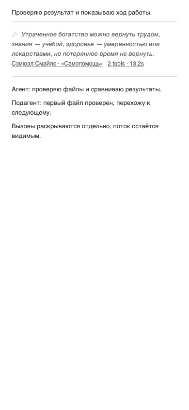
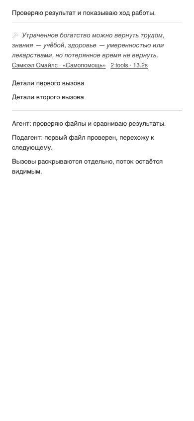
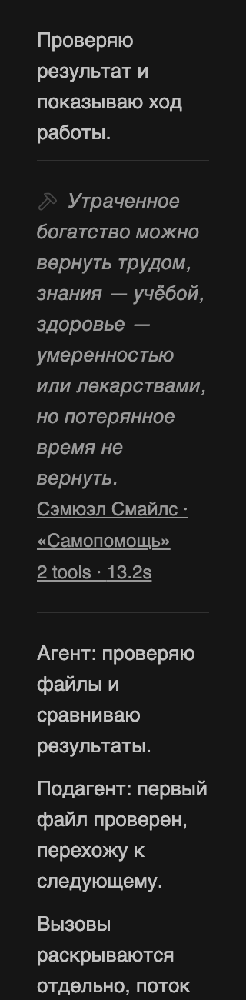
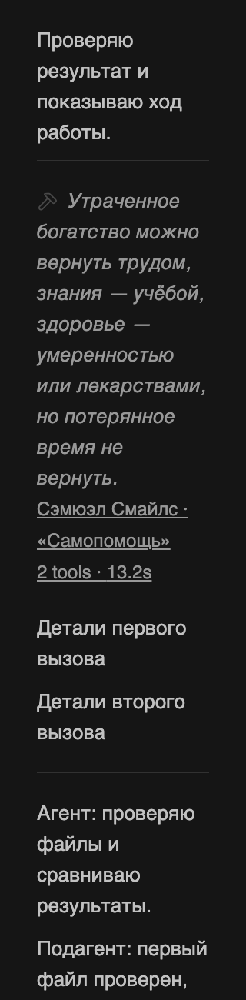

# Minus — поток завершённого этапа и раскрытие по метрикам

Владелец поручил пересчитывать время после окончания этапа, оставлять полезный стриминг видимым и раскрывать вызовы по нажатию на их количество и время. Исправление и установка продолжают принятую задачу текущего треда. Текущая визуальная основа — [просторные разделители от 30 октября](2026-10-30-spacious-dividers.md), принятые словами «Теперь свободнее, оставляем»: родной серый BB, цитата → русский автор/источник → метрики, перенос по ширине и отступы около разделителей. Подборка Бон в эту редакцию не включается.

## Причина и результат

Прежняя проверка видимости охватывала отдельные строки. В настоящем BB завершённый этап сворачивается целиком под «Worked for»: промежуточные сообщения агента становятся дочерними строками turn. Обычный ответ API возвращает `children=null`, поэтому Minus не видел ни текста, ни окончательных времён внутри этапа. Это пробел предыдущей проверки: старое ревью отступов не подтверждало весь сценарий виджета.

В режиме сворачивания инструментов Minus раскрывает существующую нативную кнопку завершённого этапа. Текст агента остаётся видимым, а инструменты внутри turn группируются отдельно. Ручное закрытие этапа сохраняется при обновлении DOM и возврате после виртуализации; выключение плагина убирает только собственное автоматическое раскрытие. Делегированные и workflow-потоки сохраняют нативное поведение.

Публичный SDK `threads.timeline` вызывается с `includeNestedRows=true`, чтобы получить окончательные timestamps. `thread:changed` инициирует обновление, terminal status/`turn/completed` обходит прежний двухсекундный throttle. Событие, пришедшее во время запроса, сохраняется в очереди с forced-флагом. После realtime reconnect выполняется повторная сверка. Формула не меняется: сумма индивидуальных длительностей вызовов; при неизвестных timestamps отображается `time unavailable`. [Независимое сложение timestamps настоящего API](verification/2026-10-30-turn-stream/timing-check.json) подтвердило значения трёх групп: 12 066, 1142 и 569 ms соответствуют отображённым 12.1s, 1.1s и 569ms.

Количество вызовов и время теперь одна нативная кнопка, оформленная как серая подчёркнутая ссылка. Она управляет тем же раскрытием, что и цитата. Ссылка источника остаётся отдельной. Клавиатурный фокус метрик сохраняется при миграции сводки после API-ответа.

## Проверка точной редакции

[Хеши исходников](verification/2026-10-30-turn-stream/source-hashes.txt), [diff от d751084](verification/2026-10-30-turn-stream/source.diff), [45 DOM/content тестов](verification/2026-10-30-turn-stream/tests.xml) и [браузерные измерения](verification/2026-10-30-turn-stream/browser.json) относятся к одному кандидату. Strict TypeScript, plugin build и diff-check прошли. SDK pin 0.6.79 сохранён; установленный BB собирает совместимый bundle SDK 0.6.94. Исходники BB/SDK/vendor не меняются.

Тесты покрывают children завершённого turn, финальные timestamps, forced-refresh во время inFlight, manual close/remount, cleanup, исключение delegated turn, одинаковое раскрытие цитаты/метрик и сохранение фокуса. В изолированном клиенте настоящего BB кандидат показал четыре видимых промежуточных сообщения и три скрытые tool-группы в ранее завершённом этапе. Enter раскрывает вызовы через метрики, Space сворачивает. Первый прогон ожидания turn закончился таймаутом; диагностический повтор на неизменённых исходниках прошёл. Приватные snapshots остаются в thread storage и в Git не публикуются.

Impeccable / harden / Operate и Frontend Design применены к принятой основе. Проверены 96 сочетаний восьми источников, трёх ширин поля 728/358/288, двух тем и масштаба 100/200%; в каждом закрытие, focus, раскрытие и повторное закрытие с ожиданием нужного `aria-expanded` — 384 состояния без геометрических нарушений. Числа матрицы унаследованы из принятой проверки отступов, новых ограничений интерфейса нет. Проверены перенос, общий серый цвет, видимость потока и интервалы: четыре шага `--spacing` внутри/после линии, два шага по горизонтали. Четыре PNG просмотрены writer; метод — isolated headless Chromium с текущими CSS BB и модулем кандидата. Физический телефон не проверялся.

Раскрытие и узкая тёмная версия при 200%

Независимый reviewer thr_bik4dfgafw не обнаружил P0/P1/P2 на указанных байтах. Он просмотрел четыре PNG, independently пересчитал времена API, проверил forced-флаг, reconnect/unsubscribe и границы native/delegated turn. [Настоящий active → completed переход](verification/2026-10-30-turn-stream/transition.json) после его ответа подтверждён writer: candidate JS/CSS загружены, этап завершился, нативная сводка раскрыта автоматически, оба промежуточных сообщения видимы, инструменты закрыты, pageerrors отсутствуют. Все финальные вызовы имеют timestamps; приватные ID/текст исключены из публикуемого evidence. Остаются публикация и разрешённая установка с отдельным read-back. Settings → Minus сохраняется; rails N/A, новая точка быстрого доступа не поручена. Нового поиска готовых решений не требуется: устраняются подтверждённые дефекты принятой реализации.

## Доставка и откат

Назначенный writer — текущий тред. Ветка `bb/minus-tool-call-quotes`, открытый PR [#2](https://github.com/n30g30/bb-plugin-minus/pull/2); merge этой редакции не выполняется. Workflows отсутствуют в HEAD, fork main и upstream main; Actions не запускаются. Установлен исходник `d75108457487d7f7e11e8eadb79c1010ca394219`, bundle `c6f1e8140181e459`, enabled/running. До записи отдельно прочитаны install/update jobs: активных нет. Сохранены все 31 boolean settings, включён только `collapseToolCalls`. Backend содержит только settings: storage, secrets, schedules и host entry отсутствуют.

Установка exact проверенного commit выполняется штатными CLI-операциями. Pinned source заменяется через remove/install с восстановлением актуальных settings; старый точный Git source и сохранённые значения обеспечивают обратный путь. Общий BB/сервер не останавливается и не перезапускается. После установки отдельно сверяются source, artifact, enabled/status, settings, известные jobs и ошибки, затем пользовательский сценарий в живом frontend. Квитанции и приватные UI-снимки сохраняются локально, фактический этап доставки записывается отдельно.

## Сверка процесса и сценариев

| Исходное состояние и действие | Ожидается | Доказательство кандидата |
|---|---|---|
| Этап завершён, родной «Worked for» закрыт; включён Minus collapse | Текст этапа видим, инструменты внутри скрыты | Реальный completed turn в disposable frontend; snapshots локальны |
| Вызов pending; приходит terminal event при незавершённом API-запросе | Следующий forced refresh получает окончательное время | Регрессионные DOM-тесты с управляемым clock/API |
| Пользователь закрывает нативный этап; DOM обновляется или строка возвращается | Явное закрытие сохраняется | Регрессионные тесты manual close/remount |
| Пользователь нажимает цитату или количество/время | Одна и та же группа раскрывается; источник отдельно | DOM-тесты, Enter/Space в настоящем frontend и browser matrix |
| API заменяет fallback-сводку во время focus на метриках | Фокус остаётся на кнопке метрик | Регрессионный тест миграции |
| Узкое поле, длинная подпись, 200% текста, обе темы | Полный перенос, видимый stream, сохранены цвета и интервалы | Browser matrix и четыре просмотренных PNG |
| Minus выключается | Собственные markers исчезают; native выбор пользователя сохраняется | Cleanup DOM-тесты; живой toggle общей настройки ради теста не выполнялся |

Это запись исполнения уже порученных требований, не новый каталог сценариев и не новая продуктовая развилка. `bb-plugin-workflow` и `bb-plugin-authoring`: проверены публичные SDK-контракты, manifest, сборка, lifecycle, данные, settings и границы install; `impeccable` и `frontend-design`: проверены иерархия, нативный цвет/типографика, перенос, фокус, темы, отступы и раскрытие. Текущий тред до правок и при проверке имеет имя «I — plugins: Minus»; отдельной поверхности имени задачи в BB нет.
